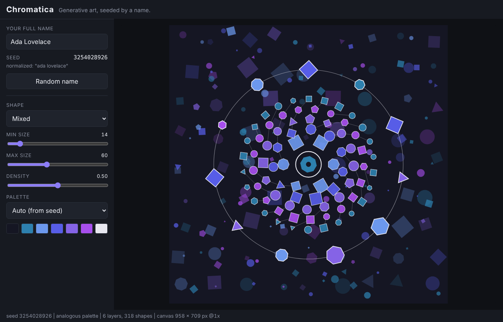
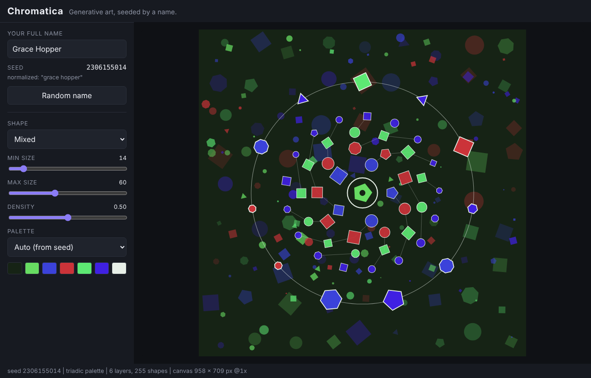

# Chromatica

A generative art and colour studio where **your name is the seed**.
Type a name, get a unique artwork. Type the same name again, get the exact same artwork.

| Ada Lovelace | Grace Hopper |
|---|---|
|  |  |

> Status: **Week 2 complete** (seeded generation, palettes, name signature, controls).
> Week 3 adds a fractal pattern, SVG/PNG export and saved favourites.
> See [docs/ROADMAP.md](docs/ROADMAP.md).

## How it works

```
"Your Full Name" -> normalize -> hash -> 32-bit seed -> forked PRNG streams
                                                     \-> palette / layout / pattern
name letters ---------------------------------------> signature ring
                          all of it -> scene description -> Canvas renderer (SVG in Week 3)
```

1. **Seed.** The name is trimmed, lower-cased, Unicode-normalized and whitespace-collapsed,
   then hashed (xmur3) to a 32-bit integer. `"  ADA   lovelace "` and `"Ada Lovelace"` give one seed.
2. **Streams.** A mulberry32 PRNG is forked into independent streams (`palette`, `layout`,
   `pattern`, `signature`). A stream depends only on the seed and its label, never on how many
   numbers another stream has drawn, so one part of the art can change without shifting the rest.
3. **Palette.** A base hue plus a hue relationship: complementary, analogous or triadic
   (picked by the seed, or chosen in the UI), with a light or dark background.
4. **Name signature.** Every letter becomes a polygon on a ring around the centre. The letter's
   code point decides its sides, size, rotation and colour, so the name is visible in the art.
5. **Scene.** Six layers of plain data: texture, scatter, web, rings, signature, focus.
   Renderers turn the data into pixels.

## Controls

| Control | Effect |
|---|---|
| Name | Re-seeds everything. The numeric seed is shown beside it. |
| Random name | Fills in a famous name. |
| Shape | Mixed, circles, squares or polygons. Positions stay put when you change it. |
| Min / max size | Range of shape sizes. |
| Density | How many shapes appear in the texture and scatter layers. |
| Palette | Auto (from seed), complementary, analogous or triadic. |

You can also open `index.html?name=Grace%20Hopper` to start with a given name.

## Run it

No build step and no dependencies. ES modules need an HTTP server (not `file://`):

```bash
npm start            # or: python3 -m http.server 8000
# open http://localhost:8000
```

## Test it

Requires Node 20+.

```bash
npm test
```

The suite includes determinism tests (same name, same first 100 random numbers; same name,
identical scene), stream-independence tests, palette hue-relationship tests, edge cases
(empty names, emoji, accents, 500-character names) and a check that no source file calls
`Math.random`. A few values are pinned so that any accidental change to the v1 algorithm fails loudly.

## Project structure

```
chromatica/
├── index.html
├── style.css
├── src/
│   ├── main.js            # UI wiring: controls -> generate -> render
│   ├── canvas.js          # HiDPI-aware responsive canvas controller
│   ├── seed.js            # normalize + hash
│   ├── prng.js            # mulberry32, fork(), createStreams()
│   ├── palette.js         # complementary / analogous / triadic
│   ├── signature.js       # name -> ring of letter shapes
│   ├── generator.js       # (name, params) -> scene description
│   ├── scene.js           # scene description + shape constructors
│   ├── geometry.js        # grid / radial / scatter layouts, polygon maths
│   ├── render-canvas.js   # scene -> Canvas 2D
│   ├── names.js           # "Random name" button (UI only)
│   └── demo.js            # fixed Week 1 composition, kept as a reference scene
├── tests/
│   ├── week1.test.mjs
│   └── week2.test.mjs
└── docs/
    ├── ROADMAP.md
    └── screenshot-*.png
```

## Roadmap

| Week | Focus | State |
|------|-------|-------|
| 1 | Canvas rendering, geometry, layouts, scene graph | Done |
| 2 | Name -> seed -> PRNG, palettes, name signature, controls | Done |
| 3 | Fractal pattern, SVG/PNG export, favourites, polish | Next |
