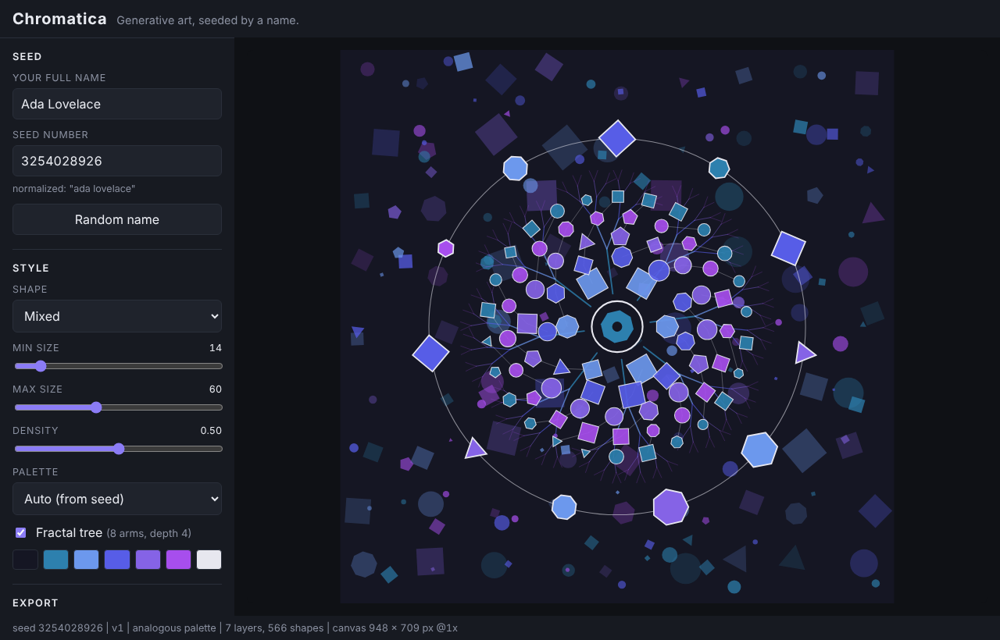
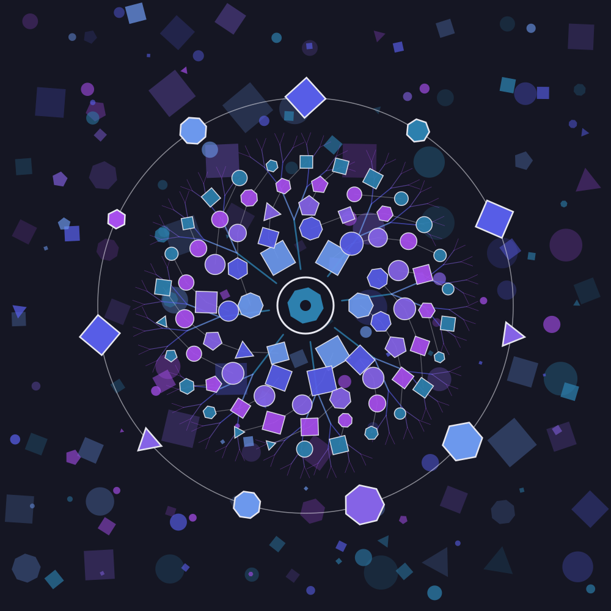
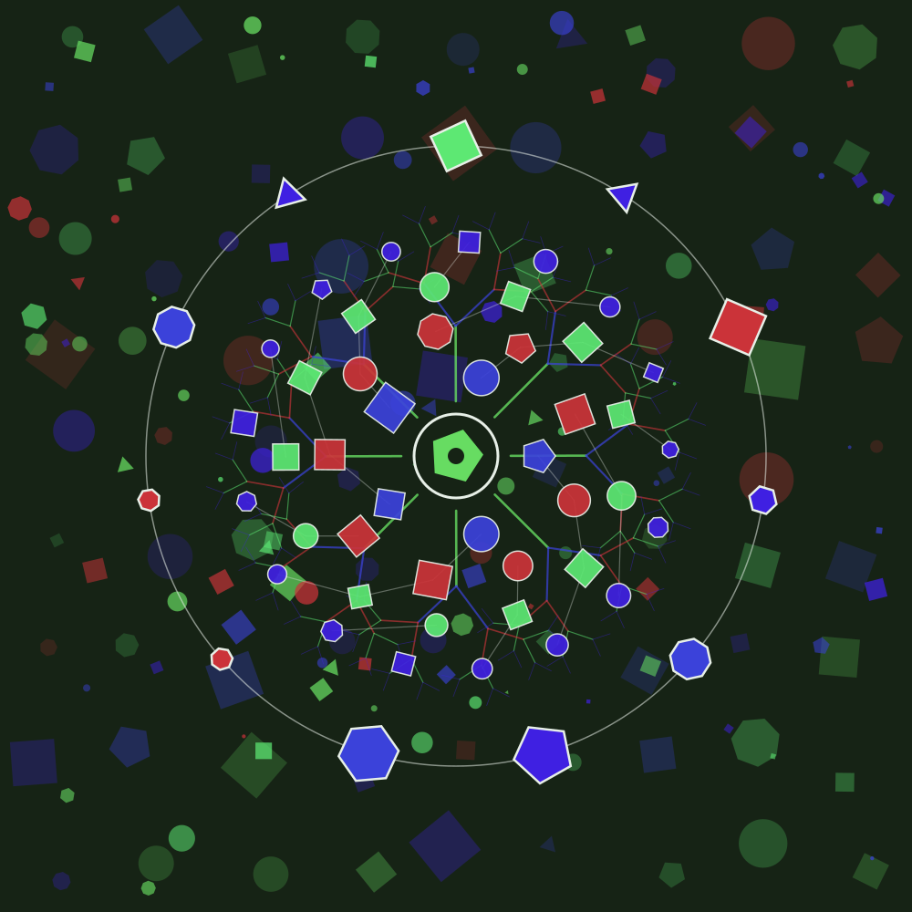
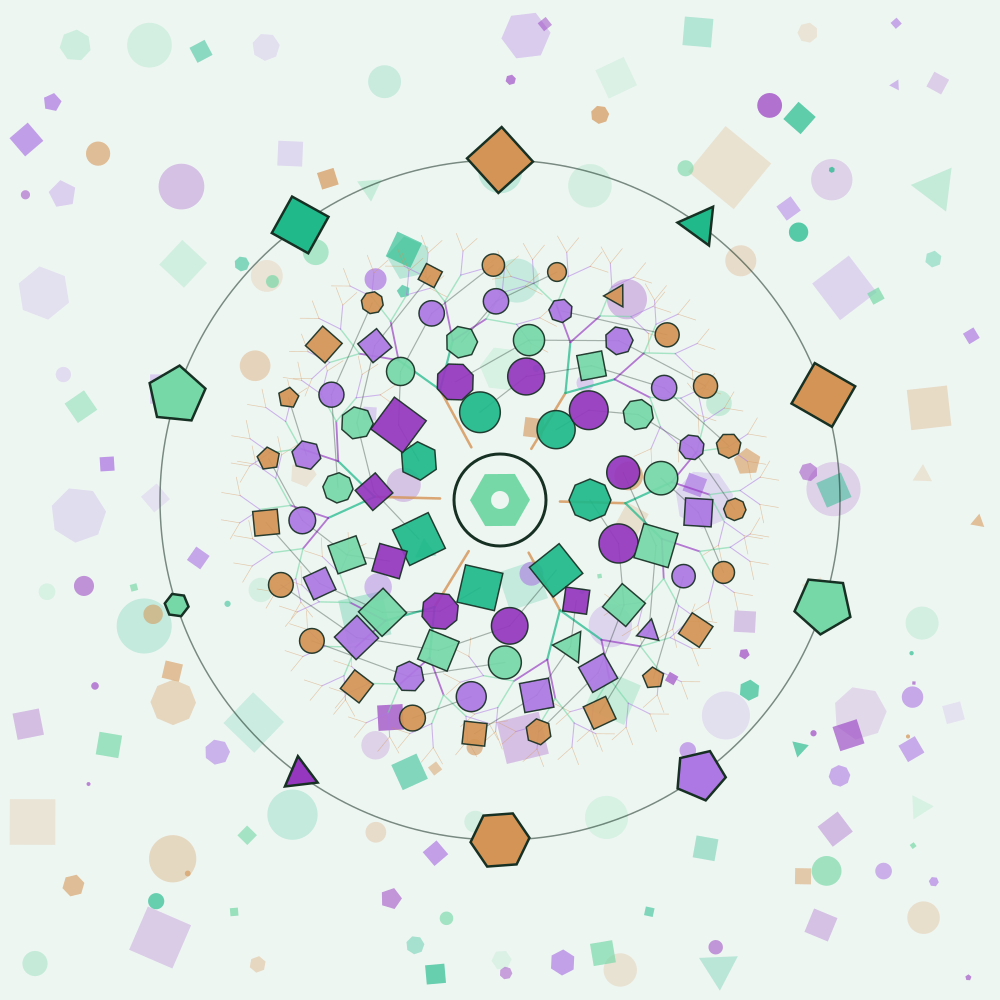
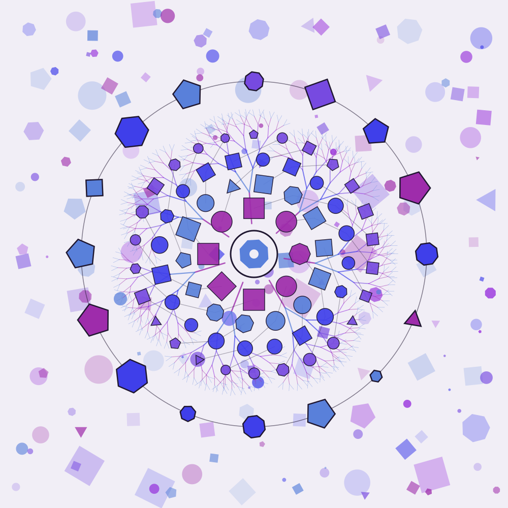
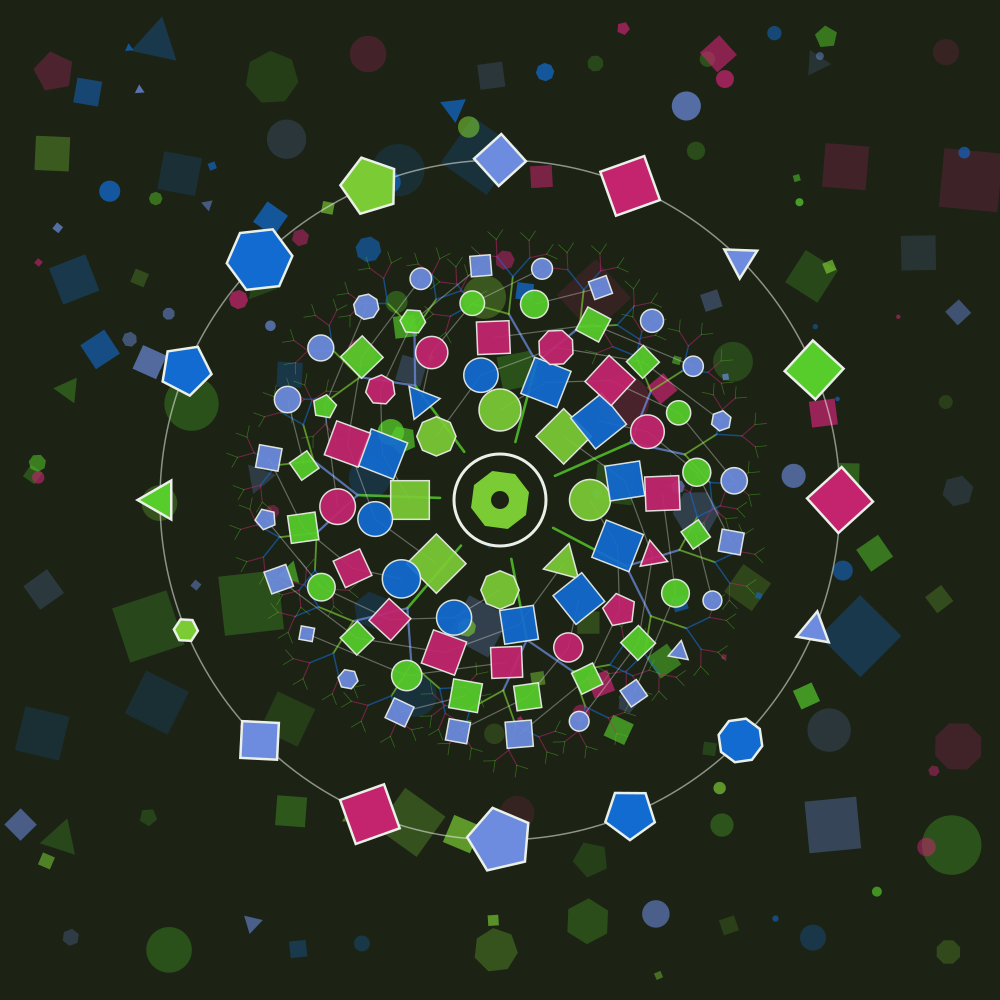
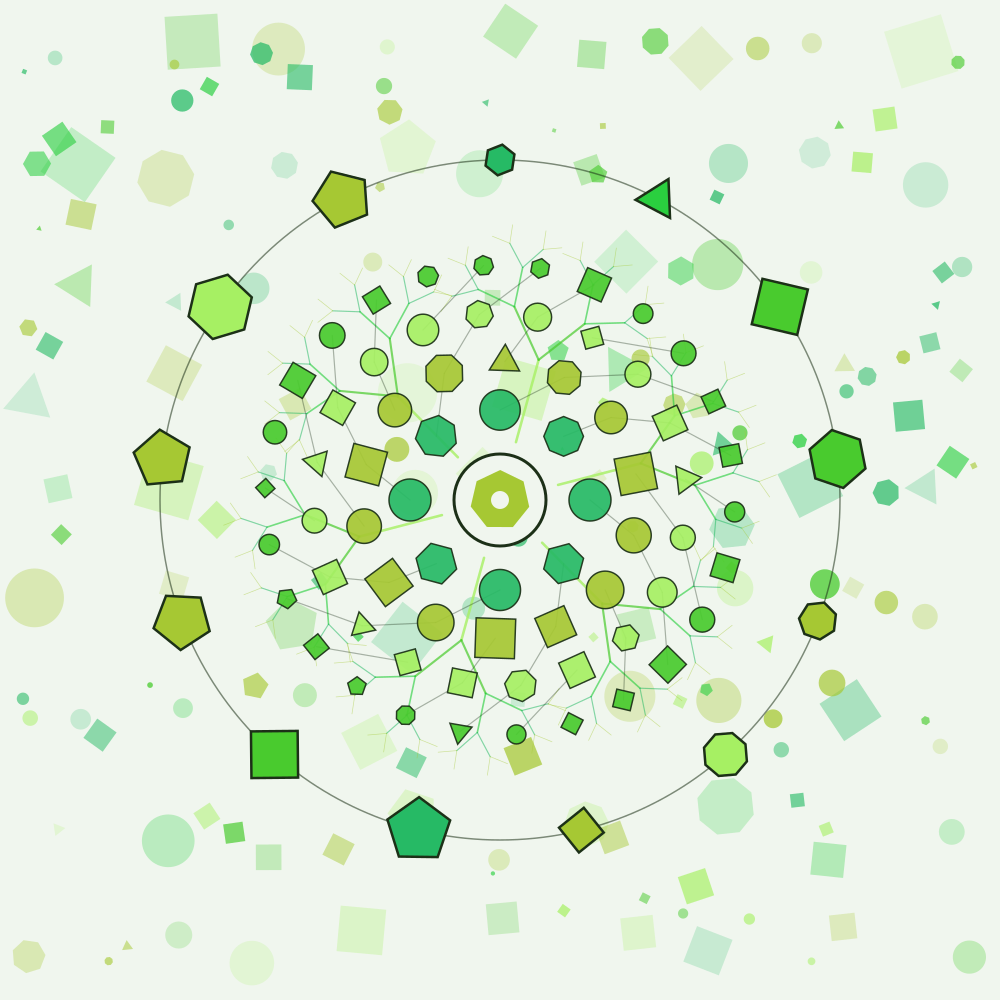

# Chromatica

A generative art and colour studio where **your name is the seed**.
Type a name, get a unique artwork. Type the same name again, get the exact same artwork.
Every piece has a numeric seed, so any artwork can be reproduced exactly later.



## Gallery

Each image is a real export (`npm run gallery`) of a famous name, left at the default settings.

| | | |
|---|---|---|
|  |  |  |
| Ada Lovelace | Grace Hopper | Alan Turing |
|  |  |  |
| Katherine Johnson | Margaret Hamilton | Claude Shannon |

Type your own name to find yours.

## How it works

```
"Your Full Name" -> normalize -> hash -> 32-bit seed -> forked PRNG streams
                                                     \-> palette / layout / fractal / rings
name letters ---------------------------------------> signature ring
        recipe = { algorithm, seed, text, params } -> scene description -> Canvas | SVG | PNG
```

1. **Seed.** The name is trimmed, lower-cased, Unicode-normalized and whitespace-collapsed,
   then hashed (xmur3) to a 32-bit integer. `"  ADA   lovelace "` and `"Ada Lovelace"` give one seed.
2. **Streams.** A mulberry32 PRNG is forked into independent streams (`palette`, `layout`,
   `pattern`, `signature`). A stream depends only on the seed and its label, never on how many
   numbers another stream has drawn, so one part of the art can change without shifting the rest.
3. **Palette.** A base hue plus a hue relationship: complementary, analogous or triadic
   (picked by the seed, or chosen in the UI), with a light or dark background.
4. **Fractal tree.** Recursive branching arms. The seed decides the arm count (4 to 8), depth
   (4 to 6), branch ratio, spread and twist. Branch lengths are scaled so the pattern always fits
   its radius.
5. **Name signature.** Every letter becomes a polygon on a ring around the centre. The letter's
   code point decides its sides, size, rotation and colour, so the name is visible in the art.
6. **Scene.** Seven layers of plain data: texture, scatter, fractal, web, rings, signature, focus.
   Two renderers read the same data: Canvas for the live view and PNG, and a string-based SVG writer.

## Reproducing an artwork

- **By name.** Type the name (case, spacing and accents do not matter).
- **By number.** Type the seed into the Seed number box. All layers match the original except the
  letter ring: a hash cannot be reversed into letters, so seed mode draws the ring from the
  digits of the seed instead.
- **By link.** The URL always reflects the artwork: `?name=Grace+Hopper&palette=triadic` or `?seed=3254028926`.
- **From a favourite.** Saved favourites store the full recipe, including the algorithm version.

## Versioning

Every artwork records the algorithm that made it (`v1`) in its recipe, in saved favourites and
inside exported SVGs. The generator for each version is frozen. To change the look, add a `v2`
beside `v1` instead of editing it, and old favourites keep rendering exactly as saved.
Unknown versions throw an error instead of silently drawing something different.

## Controls

| Control | Effect |
|---|---|
| Name | Re-seeds everything. |
| Seed number | Jump to any seed from 0 to 4,294,967,295. |
| Random name | Fills in a famous name. |
| Shape | Mixed, circles, squares or polygons. Positions stay put when you change it. |
| Min / max size | Range of shape sizes. |
| Density | How many shapes appear in the texture and scatter layers. |
| Palette | Auto (from seed), complementary, analogous or triadic. |
| Fractal tree | Show or hide the fractal layer. Every other layer stays identical. |
| Download PNG / SVG | PNG is 2048 x 2048. SVG is vector, with one group per layer. |
| Favorites | Saved in your browser (`localStorage`), newest first, up to 60. |

## Run it

No build step and no dependencies. ES modules need an HTTP server (not `file://`):

```bash
npm start            # or: python3 -m http.server 8000
# open http://localhost:8000
```

## Test it

Requires Node 20+.

```bash
npm test
```

The suite covers: determinism (same name gives the same first 100 random numbers and an identical
scene), stream independence, palette hue relationships, fractal geometry (segment counts, reach,
parent-child joins), seed parsing, recipe versioning, SVG structure and escaping, favourites
(including blocked, full and corrupt storage), URL state, and edge cases such as empty names,
emoji, accents and 500-character names. A few values are pinned so any accidental change to the
v1 algorithm fails loudly. A test also checks that no source file calls `Math.random`.

## Deploy

`.github/workflows/pages.yml` runs the tests and publishes the static site to GitHub Pages on every
push to `main`. Enable it once under Settings > Pages > Source: GitHub Actions.
`.github/workflows/ci.yml` runs the tests on pull requests.

## Project structure

```
chromatica/
├── index.html
├── style.css
├── src/
│   ├── main.js            # UI wiring: controls -> recipe -> scene -> render
│   ├── state.js           # UI state <-> URL query <-> recipe (no DOM)
│   ├── canvas.js          # HiDPI-aware responsive canvas controller
│   ├── seed.js            # normalize, hash, strict seed parsing
│   ├── prng.js            # mulberry32, fork(), createStreams()
│   ├── palette.js         # complementary / analogous / triadic
│   ├── signature.js       # name -> ring of letter shapes
│   ├── fractals.js        # recursive tree geometry
│   ├── generator.js       # recipe -> scene description, versioned (v1)
│   ├── scene.js           # scene description + shape constructors
│   ├── geometry.js        # grid / radial / scatter layouts, polygon maths
│   ├── render-canvas.js   # scene -> Canvas 2D
│   ├── render-svg.js      # scene -> SVG string
│   ├── export.js          # file names, PNG / SVG downloads
│   ├── storage.js         # favourites in localStorage
│   ├── names.js           # "Random name" button (UI only)
│   └── demo.js            # fixed Week 1 composition, kept as a reference scene
├── scripts/
│   └── build-gallery.mjs  # writes docs/gallery/*.svg
├── tests/
│   ├── week1.test.mjs
│   ├── week2.test.mjs
│   └── week3.test.mjs
├── docs/
│   ├── ROADMAP.md
│   ├── gallery/
│   └── screenshot-*.png
└── .github/workflows/     # ci.yml, pages.yml
```

## Roadmap

| Week | Focus | State |
|------|-------|-------|
| 1 | Canvas rendering, geometry, layouts, scene graph | Done |
| 2 | Name -> seed -> PRNG, palettes, name signature, controls | Done |
| 3 | Fractal pattern, SVG/PNG export, favourites, versioning | Done |
