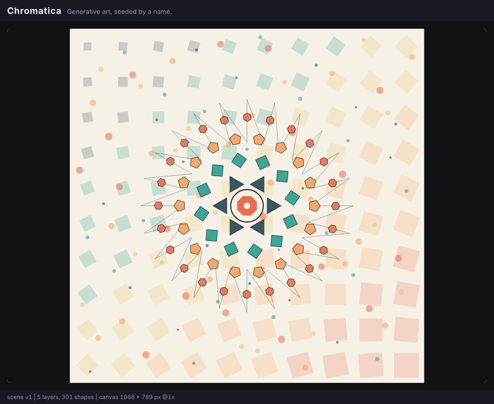

# Chromatica

A generative art and colour studio where **your name is the seed**.
Type a name, get a unique artwork. Type the same name again, get the exact same artwork.



> Status: **Week 1 complete** (canvas rendering, shapes, layouts, scene graph).
> See [docs/ROADMAP.md](docs/ROADMAP.md) for what comes next.

## How it works

```
"Your Full Name" -> normalize -> hash -> 32-bit seed -> PRNG -> every random choice
                                                   \-> scene description -> Canvas / SVG renderer
```

The generator builds a **scene description** (plain data: layers of shapes in a
1000 x 1000 logical space). Renderers turn that data into pixels. Because the two
are separate, SVG export and testing come almost for free.

## Run it

No build step and no dependencies. ES modules need an HTTP server (not `file://`):

```bash
npm start            # or: python3 -m http.server 8000
# open http://localhost:8000
```

## Test it

Requires Node 20+.

```bash
npm test
```

## Project structure

```
chromatica/
├── index.html
├── style.css
├── src/
│   ├── main.js            # entry: generate scene, render on resize
│   ├── canvas.js          # HiDPI-aware responsive canvas controller
│   ├── scene.js           # scene description + shape constructors
│   ├── geometry.js        # grid / radial / scatter layouts, polygon maths
│   ├── demo.js            # hardcoded Week 1 composition (generator side)
│   └── render-canvas.js   # scene -> Canvas 2D (renderer side)
├── tests/
│   └── week1.test.mjs
└── docs/
    ├── ROADMAP.md
    └── screenshot-week1.png
```

## Design notes

- **Resolution independent.** Scenes use logical units; the renderer fits them
  to the viewport and `devicePixelRatio`.
- **Deterministic by construction.** No `Math.random()`. Scatter uses a Halton
  sequence now; a seeded PRNG replaces constants in Week 2.
- **Layers.** Each scene is an ordered list of named layers (grid, scatter, web,
  rings, focus in the demo).

## Roadmap

| Week | Focus | State |
|------|-------|-------|
| 1 | Canvas rendering, geometry, layouts, scene graph | Done |
| 2 | Name -> seed -> PRNG, palettes, name signature, controls | Next |
| 3 | Fractal pattern, SVG/PNG export, favourites, polish | Planned |
